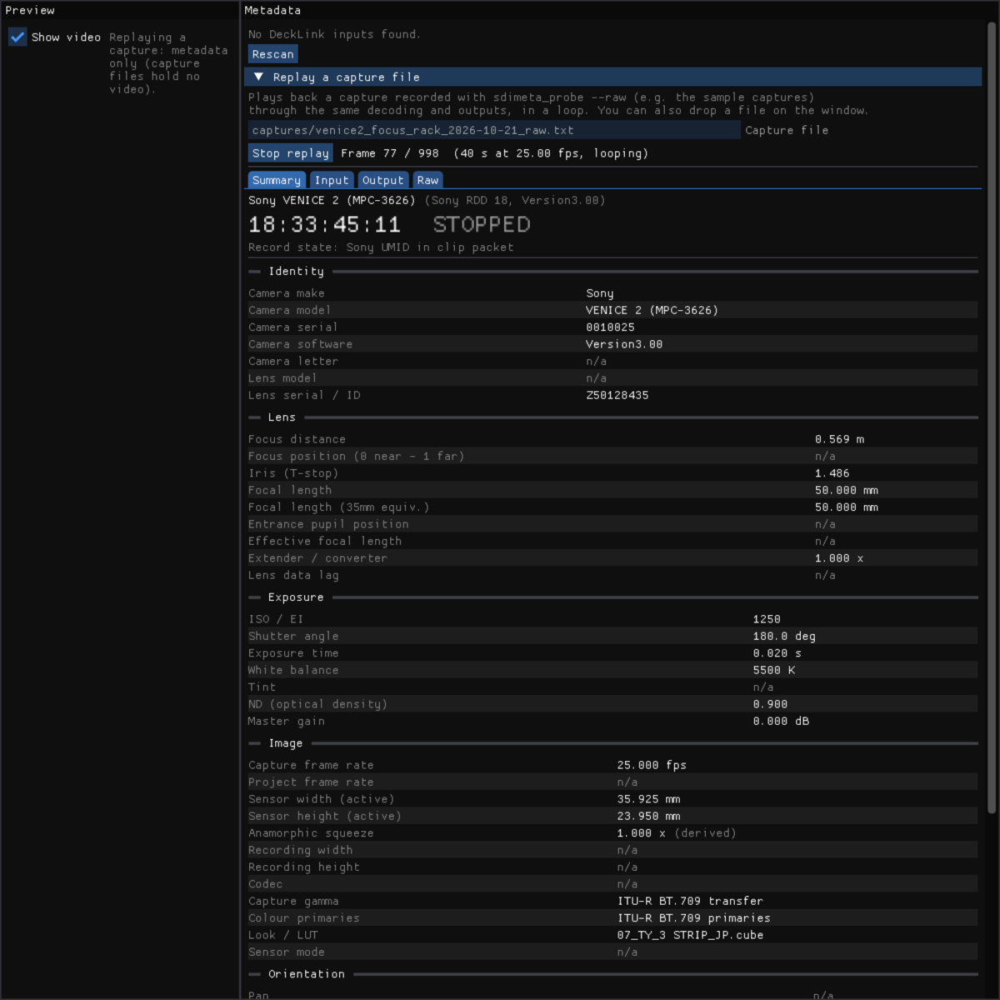

# SDI Metadata Viewer

Reads per-frame camera metadata from an SDI feed on a Blackmagic DeckLink / UltraStudio device and sends it to
Stage Precision, Unreal Engine or anything else that speaks **FreeD**, **OSC** or **OpenTrackIO**. The aim is to get
lens data (focus / iris / zoom), camera orientation, timecode and record state from the same SDI cable that already
carries the picture, instead of running extra data cables from the lens system.

The camera is detected automatically and only the data it actually supplies is shown and sent.

**Download:** macOS and Windows builds are on the [Releases page](../../releases). **Manual:** [docs/MANUAL.md](docs/MANUAL.md).
No camera to hand? The release includes sample captures from real cameras you can replay in the app.

If it's useful to you, you can support its development:

<a href="https://buymeacoffee.com/nickdiacre"></a>



## What each camera provides

Verified on real hardware with an UltraStudio Express Recorder 3G and a DeckLink 8K Pro (DeckLink SDK 16, macOS).

| | Sony VENICE 2 | Sony BURANO | ARRI ALEXA Mini LF | Blackmagic URSA | RED V-RAPTOR |
|---|---|---|---|---|---|
| Format | RDD 18 (43/05) + clip KLV (44/04) | same | ARRI 4 KB block (44/04, lines 9-11) | Camera control (51/53) | Timecode user bits (60/60) |
| Focus distance | ✅ metres | ✅ (with electronic lens) | ✅ (LDS / /i lens, or motors + lens file) | position 0-1 only, if sent | — |
| Iris | ✅ T and f | ✅ | ✅ T | ✅ f | — |
| Focal length | ✅ (+ crop-aware 35 mm equivalent) | ✅ | ✅ | ✅ only with electronic zoom | — |
| Tilt / roll | ✅ 0.1° | same fields, not separately verified | ✅ 0.1° | — | — |
| Record state | ✅ HANC flag (8K Pro) or take UMID | Rec Run TC or clip-name changes | ✅ HANC flag (8K Pro), or Rec Run TC | ✅ (transport mode) | ✅ (user-bit flag) |
| Clip / reel | ✅ | ✅ | ✅ | — | ✅ |
| Sensor size (active) | ✅ follows imager mode | ✅ | manual (not sent) | manual | — |
| Anamorphic squeeze | ✅ 1.25-2.0 | not yet tested | ✅ | not yet tested | — |
| ISO/EI, shutter, WB, ND, fps, model, serial | ✅ (EI only, no base ISO) | ✅ | ✅ | ✅ (no model) | — |

Other ARRI bodies (ALEXA 35, LF, Mini, SXT/XT, AMIRA, 65, 265) use the same documented block; firmware differences
(for example shutter units) are handled where known. Timecode (RP 188 VITC / LTC) is read from every camera.

Lens data only exists if the camera knows it: an electronic lens (ARRI LDS, Cooke /i, ZEISS eXtended Data, Sony
E-mount) or lens motors / encoders connected to the camera. A follow-focus system that isn't connected to the camera
does not put FIZ into the SDI.

## Outputs

All outputs send once per captured frame and can run at the same time. Settings are saved between sessions.

- **FreeD** (UDP, default port 40000): standard 29-byte D1 packet. Zoom and focus are encoder counts, so their scale
  is configurable (default: focus in mm, focal length in micrometres) and must match the receiver. Iris goes in the
  spare bytes (×100). Tilt and roll fill the pan/tilt/roll fields when the camera supplies them.
- **OSC** (UDP, default port 9000): one message per variable, `<prefix>/<name>` (default prefix `/camera`), as
  float, int or string. The Output tab lists every possible variable with a checkbox; ones the current camera doesn't
  supply are greyed out and never sent. Variables: `focus`, `focus_normalised`, `iris`, `zoom`, `pan`, `tilt`,
  `roll`, `timecode`, `recording`, `clip`, `reel`, `umid`, `sensor_width`, `sensor_height`, `iso`, `shutter_angle`,
  `white_balance`, `capture_fps`, `squeeze`, `camera`, `camera_serial`, `lens`.
- **OpenTrackIO 1.0.1** ([SMPTE RIS OSVP](https://ris-pub.smpte.org/ris-osvp-metadata-camdkit/)): JSON samples with
  the standard 16-byte `OTrk` header and Fletcher-16 checksum, multicast to `239.135.1.<source number>:55555` or
  unicast. Sends lens focus distance, f/T-stop and focal length, timing with timecode, recording and slate (clip),
  plus static camera data (make, model, serial, sensor size, frame rate, ISO, shutter, squeeze) about every 2 s.
  Validated against the official schema. The camera transform (tilt and roll only) is off by default, because a
  transform with zero pan and position would override a real tracking system.

## Using it

See the [manual](docs/MANUAL.md): install, capture, the tabs, each output, record state per camera, Stage Precision
and Unreal setup, troubleshooting.

### `sdimeta_probe`: is the metadata actually arriving?

A command-line check that bypasses the decoders. Only one app can hold the input, so close the viewer first.

```bash
./build/sdimeta_probe 5            # signal, ANC packets, every timecode source, raw VANC lines
./build/sdimeta_probe 5 --dump     # plus the hex of every packet in one frame
./build/sdimeta_probe 60 --watch   # print every decoded change as it happens (REC, focus, settings...)
./build/sdimeta_probe 60 --raw     # every packet of every frame, for offline analysis
```

The raw VANC report tells "no ANC in the signal" (lines captured, blank) apart from "device not capturing VANC".

## Camera setup tips

- **Sony VENICE / VENICE 2 / BURANO:** use an SDI output with metadata enabled; on the VENICE 2 only one of the two
  outputs tested carried it. The VENICE 2 reports record state in any timecode mode (via the take's UMID); on BURANO
  use Rec Run TC (clip-name changes are a fallback).
- **ARRI:** enable SDI metadata. A manually selected lens-table entry overrides an electronic lens's own data (you get
  name and focal length but no focus or iris); clear the lens table to use the lens's data. For record state through a
  device without HANC capture, set timecode to **Rec Run**.
- **Blackmagic URSA:** iris, settings and record state are sent; focus and zoom only with lenses that report them.
- **RED:** over SDI only timecode, clip name (camera letter, reel, clip, date, wildcard) and record state. While
  stopped the clip name is the next clip.
- **SDI format:** a 3G device (like the UltraStudio Express Recorder 3G) needs HD / 3G-SDI, not 6G/12G UHD.
- **Signal chain:** vision mixers, some routers' processing, wireless links and converters often strip ANC. Test with
  a direct cable first.
- Set the camera clock: Sony and ARRI clip names include the camera date.

## Build

Requirements: CMake 3.20+, a C++17 compiler and Git. The DeckLink SDK 16.0 headers are bundled in
`third_party/decklink` (see its README); to use another SDK (12 to 16) pass `-DDECKLINK_SDK_DIR=/path/to/SDK`.
GLFW and Dear ImGui are fetched by CMake. Running the app needs the Blackmagic Desktop Video driver.

```bash
cmake -S . -B build
cmake --build build --config Release

# Parser tests only (no SDK, device or GPU needed)
cmake -S . -B build -DSDIMETA_BUILD_APP=OFF
cmake --build build && ctest --test-dir build
```

- **macOS:** Xcode command line tools. Output: `build/SDI Metadata Viewer.app`, `build/sdimeta_probe`.
- **Windows:** Visual Studio 2022 with *Desktop development with C++*; run CMake from the *x64 Native Tools Command
  Prompt* so `midl.exe` (which generates the DeckLink COM headers) is on the PATH. Output: `build\Release\`.
  Built and tested in CI; not yet run against a DeckLink device on Windows, so please report problems.
- **Linux:** X11 dev packages (`libx11-dev libxrandr-dev libxinerama-dev libxcursor-dev libxi-dev libgl-dev`);
  `-DGLFW_BUILD_WAYLAND=ON` for native Wayland.

## Known limitations

- **ARRI record flag** is a HANC packet (52/4D). The app requests it, but only devices that support HANC capture
  deliver it (the UltraStudio Express Recorder 3G does not); use Rec Run TC instead.
- **Pan** is not available from any camera; it needs a tracking system or an encoded head.
- **Tilt / roll** come from a gravity sensor: accurate when still (about 0.1-1°), disturbed by fast moves.
- **ZEISS eXtended Data** (distortion / shading curves passed through by the VENICE 2) is captured but not yet
  decoded; the ZEISS / Cooke /i spec is needed to label it.
- **Quad-link / dual-stream** inputs are not handled. Use single-link 12G or 3G/HD.
- **Preview** converts frames to BGRA on the CPU; untick *Show video* on slow machines. Decoding continues either way.

## Layout

```
src/anc/       ANC decoders, no SDK dependency (unit-tested)
  Rp214              KLV reassembly from segmented ANC (MID/PSC)
  ArriMetadata       ARRI 4 KB block
  Rdd18              Sony RDD 18 sets, lens value encodings, clip KLV + UMID
  BmdCameraControl   Blackmagic SDI camera control protocol
  MetadataProcessor  per-frame decode and record state
src/meta/      master metadata format: field registry (Fields.def), MetaRecord with provenance, per-maker adapters
src/out/       typed sample view, FreeD / OSC / OpenTrackIO, UDP, settings, sensor mode table
src/log/       JSON Lines logger
src/capture/   DeckLink enumeration, capture callback, platform shims
src/tools/     sdimeta_probe, sdimeta_coverage (generates docs/fields.json + docs/COVERAGE.md)
tools/         capture.sh: one-command test captures (docs/TEST_PLAN.md)
src/main.cpp   GLFW + Dear ImGui UI
tests/         parser tests, incl. fixtures from real Mini LF, VENICE 2, BURANO and URSA frames
captures/      probe captures from real cameras (evidence for the decoders)
```

`docs/METADATA.md` explains the master format and compares it with Pomfort Livegrade; `docs/COVERAGE.md` (generated)
shows which camera supplies each field; `docs/TEST_PLAN.md` lists the tests that close the remaining gaps. `CLAUDE.md` holds the detailed reverse-engineering notes: field offsets, encodings, how each finding was verified,
and the open issues.

## Releases

`.github/workflows/build.yml` builds macOS (universal) and Windows on every push and runs the tests. Pushing a tag
`v*` publishes a release with both zips (app, `sdimeta_probe`, sample captures):

```bash
git tag v0.1.0 && git push origin v0.1.0
```

`tools/screenshots.sh` regenerates the manual's screenshots by replaying sample captures (`--screenshots` mode).

## Log format

One JSON object per frame (Output → Log file), for example:

```json
{"frame":1204,"host_time":8123.402113,"tc":"18:24:24:00","rec":"STOPPED","rec_source":"Sony UMID in clip packet",
 "sony_clip":"A003C050_221006X4",
 "rdd18":[{"set":"01","complete":true,"items":[{"tag":"8001","name":"Focus position (image plane)",
   "value":"9.890 m  (32.45 ft)","hex":"E3DD"}, ...]}, ...],
 "anc":[{"did":"43","sdid":"05","line":11,"stream":0,"len":75,"hex":"..."}, ...]}
```

`host_time` is a monotonic clock in seconds, useful for measuring latency against tracking data.

## Licence

MIT (see [LICENSE](LICENSE)). The bundled DeckLink SDK headers in `third_party/decklink` are Blackmagic Design's,
under the notice in each file. Blackmagic, DeckLink, UltraStudio, ARRI, ALEXA, Sony, VENICE, BURANO, RED and URSA are
trademarks of their owners; this project is not affiliated with or endorsed by them.
