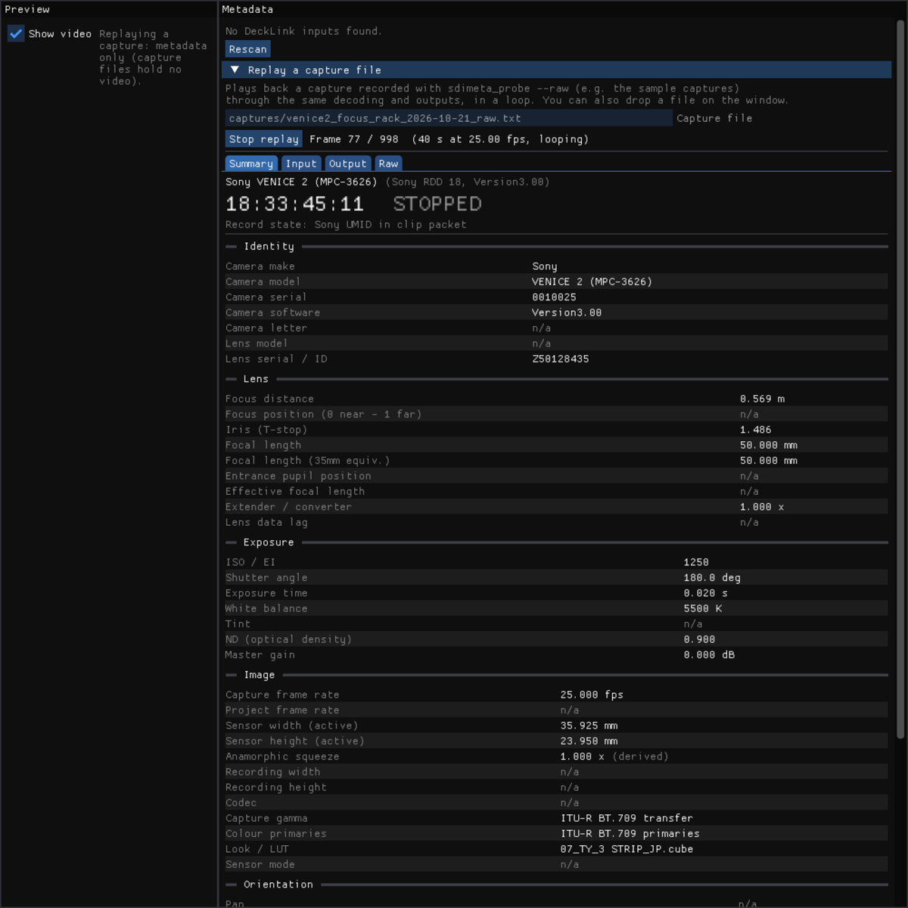
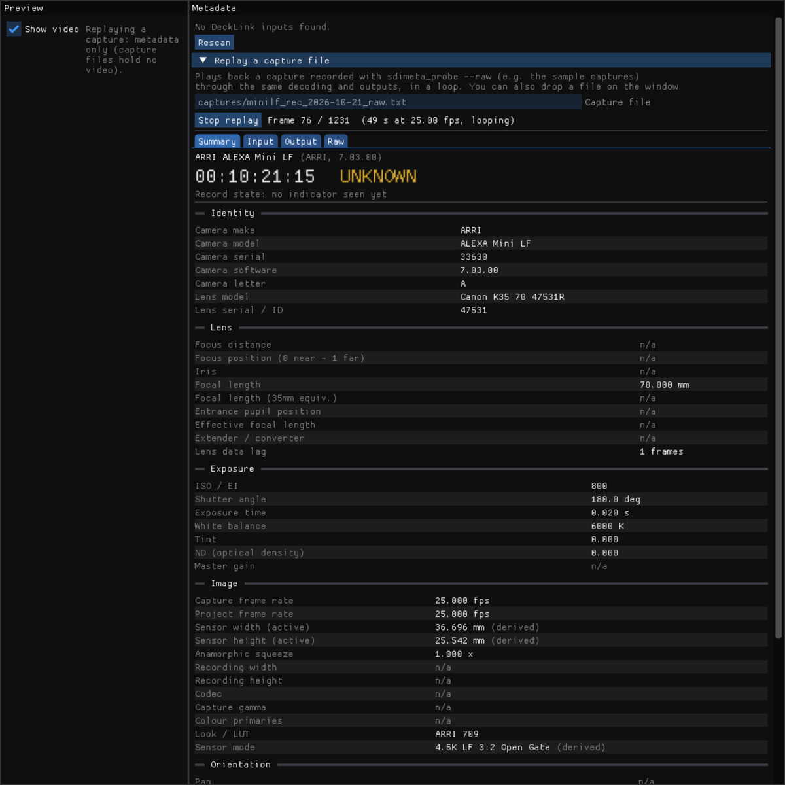
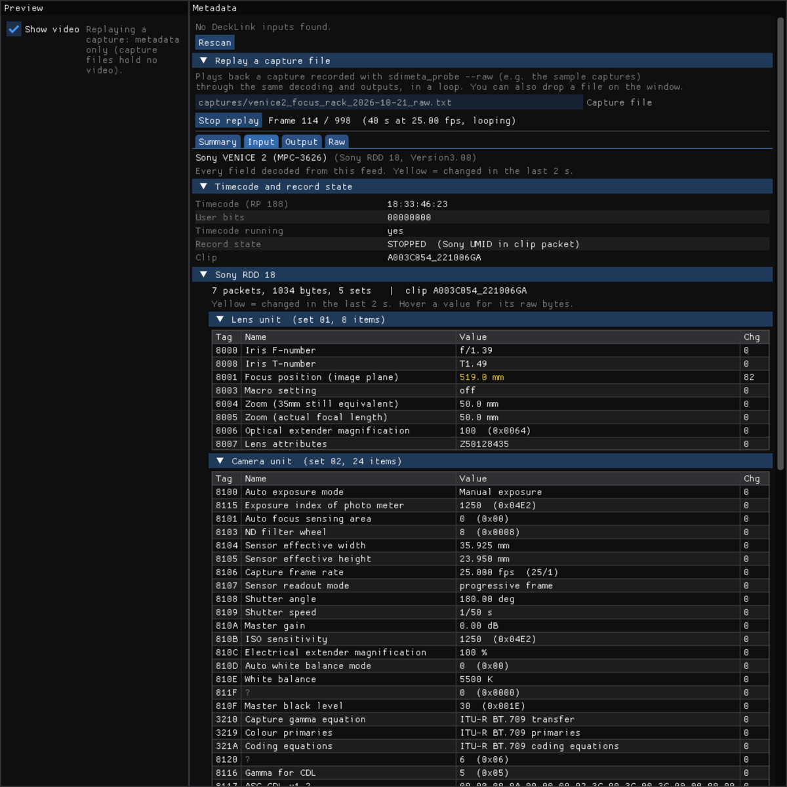
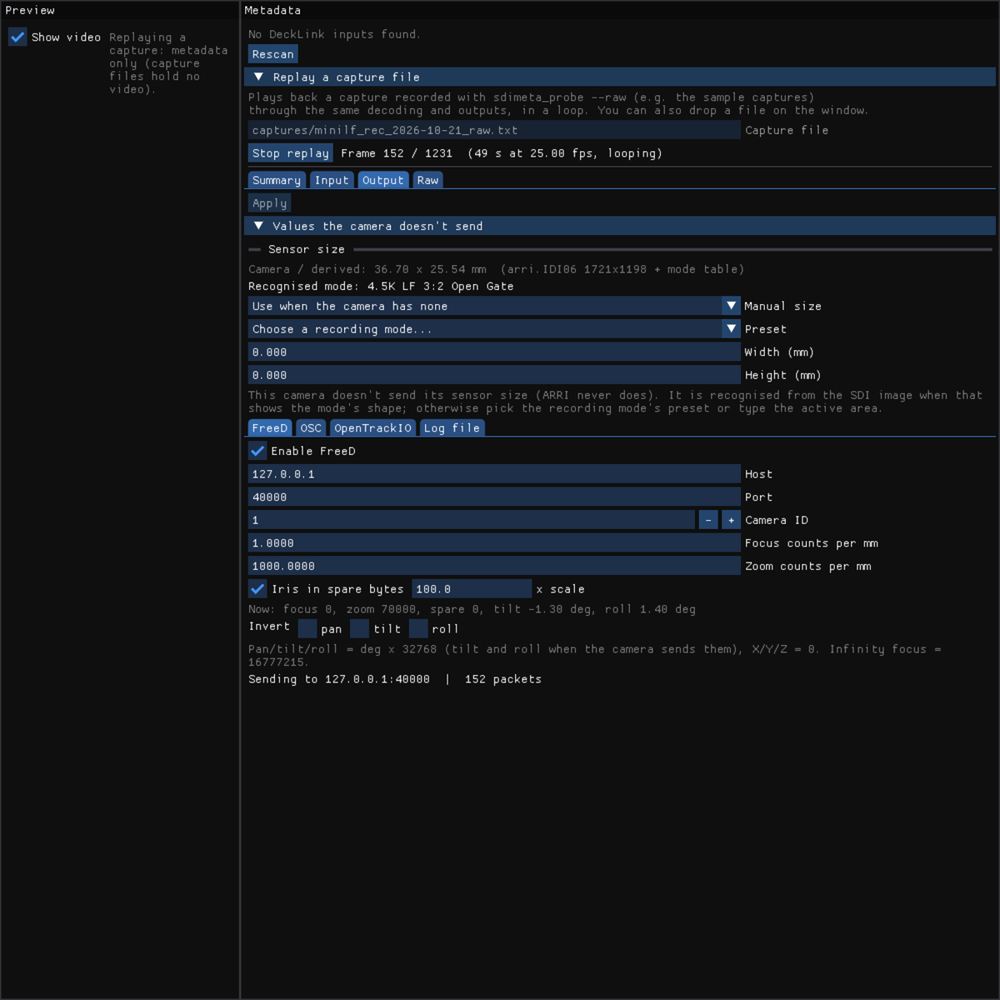
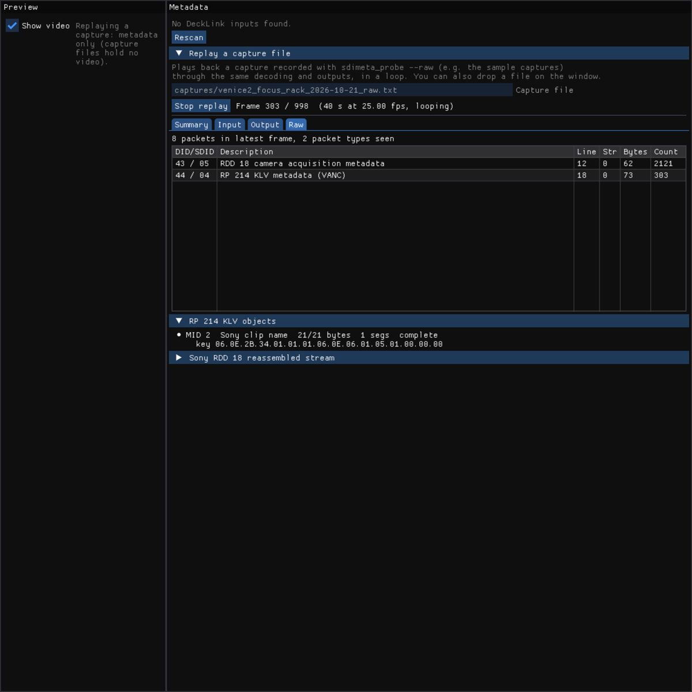
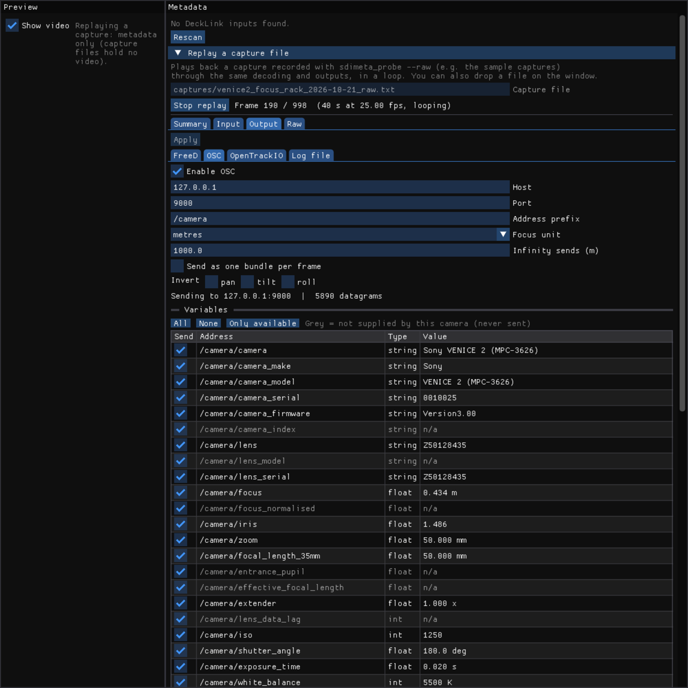
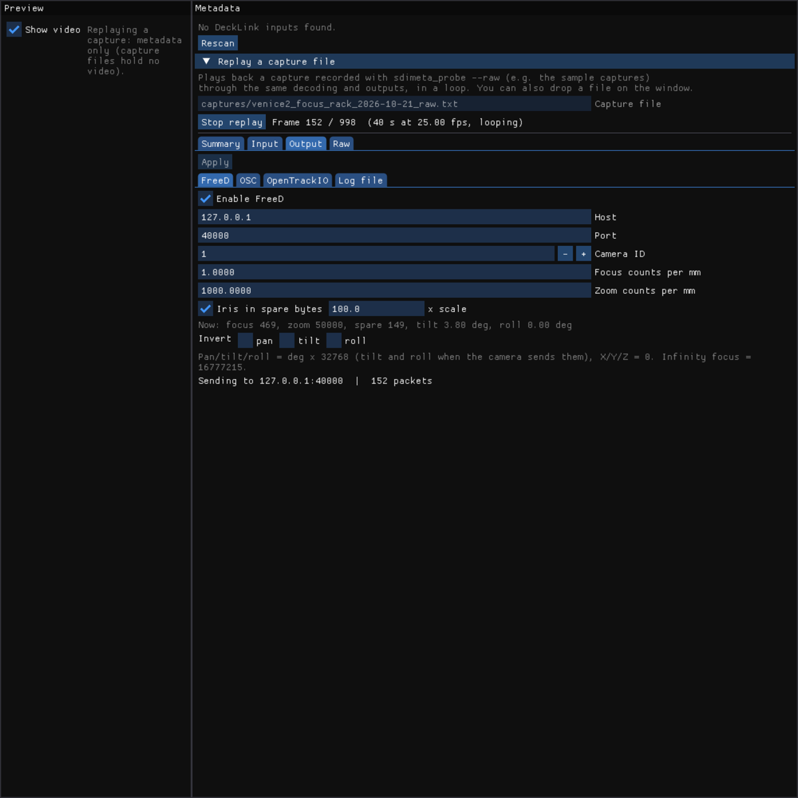
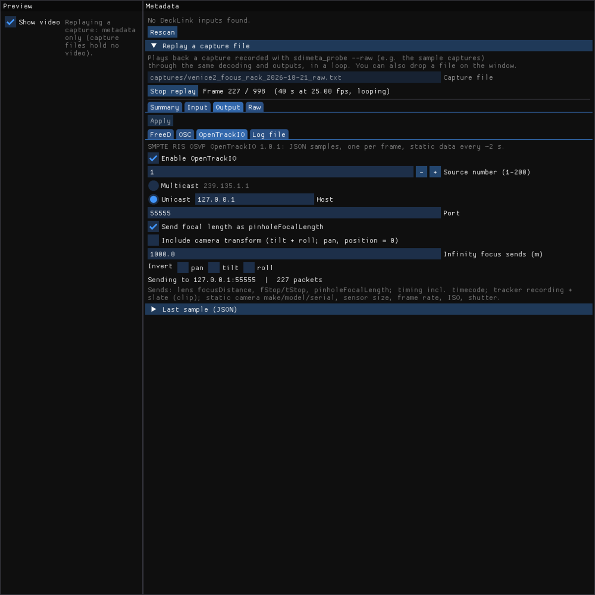
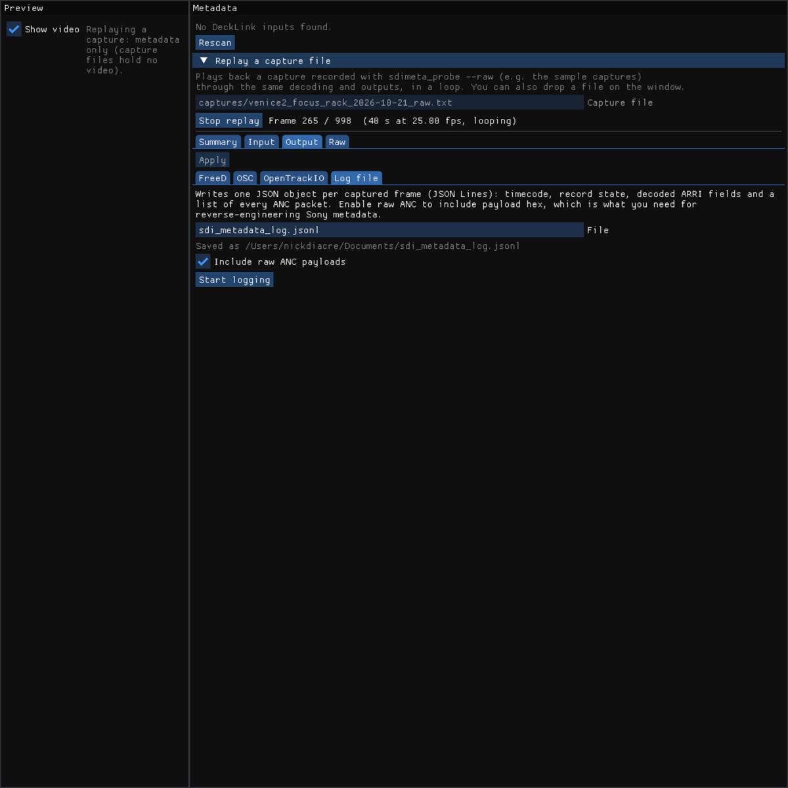

# Metadork: user manual

Metadork reads the metadata a cinema camera embeds in its SDI output (lens focus, iris and focal length,
timecode, record state, clip name, tilt and roll, exposure settings and more) through a Blackmagic DeckLink or
UltraStudio capture device. It sends that data on to **Stage Precision**, **Unreal Engine** or anything else that
speaks **FreeD**, **OSC** or **OpenTrackIO**.

The point is to get lens and take data from the SDI cable that already carries the picture, with no extra data cables
from the lens system.



The app is free and open source. If it's useful to you, you can
<a href="https://buymeacoffee.com/nickdiacre">buy me a coffee</a>:

<a href="https://buymeacoffee.com/nickdiacre"></a>

- [What you need](#what-you-need)
- [Install](#install)
- [Try it without a camera](#try-it-without-a-camera)
- [Capture from a camera](#capture-from-a-camera)
- [The tabs](#the-tabs)
- [Outputs](#outputs)
- [Record state and clip names](#record-state-and-clip-names)
- [Stage Precision](#stage-precision)
- [Unreal Engine](#unreal-engine)
- [Troubleshooting](#troubleshooting)
- [sdimeta_probe](#sdimeta_probe)
- [Files and settings](#files-and-settings)

## What you need

- **A Blackmagic capture device**: any DeckLink card or UltraStudio box that the DeckLink API supports.
  - It must handle the camera's SDI format. A 3G device needs HD / 3G-SDI from the camera, not 6G/12G UHD.
  - **HANC capture** matters for ARRI, and helps on the VENICE 2. Those cameras put their record flag in HANC
    (horizontal ancillary data), and not every device can capture it. The DeckLink 8K Pro can. The UltraStudio
    Express Recorder 3G cannot.
  - The app shows whether the selected device can capture HANC, under the input selector.
  - Without HANC, ARRI record state needs the camera in Rec Run timecode. See
    [Record state and clip names](#record-state-and-clip-names).
- **Blackmagic Desktop Video**: the driver for DeckLink / UltraStudio devices, from
  [blackmagicdesign.com/support](https://www.blackmagicdesign.com/support).
- **macOS 11 or later** (Apple Silicon or Intel), or **Windows 10/11** (64-bit).
- **A camera that embeds metadata in SDI.**

| | Sony VENICE 2 | Sony BURANO | ARRI ALEXA (Mini LF, 35, LF, Mini, 265 ...) | Blackmagic URSA | RED V-RAPTOR |
|---|---|---|---|---|---|
| Focus distance | ✅ | ✅ | ✅ | position only, if sent | — |
| Iris | ✅ T and f | ✅ | ✅ T | ✅ f | — |
| Focal length | ✅ | ✅ | ✅ | electronic zooms | — |
| Tilt / roll | ✅ | same fields (unverified) | ✅ | — | — |
| Record state | ✅ | Rec Run TC / clip changes | ✅ with HANC, or Rec Run TC | ✅ | ✅ |
| Clip / reel | ✅ | ✅ | ✅ | — | ✅ |
| Sensor size | ✅ | ✅ | recognised or manual | manual | — |
| ISO, shutter, WB, ND, fps, model, serial | ✅ | ✅ | ✅ | ✅ | — |

**Lens data only exists if the camera knows it.** That needs one of these:

- an electronic lens (ARRI LDS, Cooke /i, ZEISS eXtended Data, Sony E-mount);
- lens motors or encoders connected to the camera.

A wireless follow focus that isn't connected to the camera does not put focus data into the SDI.

## Install

Download the zip for your system from the
[Releases page](https://github.com/nickdiacre/sdi-metadata-viewer/releases). It contains:

- the app;
- `sdimeta_probe`, a command-line diagnostic tool;
- `sample-captures/`, recordings from real cameras that you can replay without hardware.

**macOS:** unzip and move **Metadork.app** to Applications. The app is not notarised by Apple, so open it
the first time with right-click → **Open** → **Open**.

The first time it sends data, macOS asks for **Local Network** access. Allow it, or nothing reaches the network. You
can change this later in System Settings → Privacy & Security → Local Network.

**Windows:** unzip anywhere and run **Metadork.exe**. If SmartScreen warns about an unrecognised app, choose
**More info** → **Run anyway**. Allow it through the Windows firewall if asked.

## Try it without a camera

Drag any file from `sample-captures/` onto the app window. You can also open **Replay a capture file**, enter the
file's path and press **Replay**.

The recording plays back in a loop through exactly the same decoding and outputs as a live input. You can see what
each camera sends, set up your receivers, and test Stage Precision or Unreal before you have a camera. Captures contain
metadata only, so the video area stays empty.

| Sample | What it shows |
|---|---|
| `venice2_focus_rack_…` | Sony VENICE 2 with a ZEISS Supreme Prime: focus pulled from 0.4 m to infinity |
| `venice2_V2-1-hanc_…` | VENICE 2 recording takes (HANC record flag) |
| `minilf_rec_…` | ARRI ALEXA Mini LF recording takes (no HANC, so record state reads Unknown) |
| `red_raptor_RD-1-rec_…` | RED V-RAPTOR recording takes (clip name and record flag in the timecode) |
| `ursa_tests_…` | Blackmagic URSA settings changes and recording |

> Replayed data goes to the enabled outputs just like live data, so a receiver will see it.

## Capture from a camera

1. **Cable** the camera's SDI output to the capture device's SDI input.
   - Start with a direct cable. Vision mixers, wireless video links, converters and some router processing remove
     embedded metadata.
   - On the VENICE 2 only one of the two SDI outputs carried metadata in our tests.
   - Make sure the camera's SDI metadata output is enabled (see the camera's manual).
2. **Pick the input port** in the panel on the right.
   - Multi-port cards (DeckLink 8K Pro etc.) list one entry per port.
   - The card's **profile** decides which ports exist and whether they are inputs. Change it with **Card profile** →
     **Activate**. This changes the whole card, including for any other app using it.
3. Capture starts as soon as a port is chosen: the preview shows the picture, and the panel fills with metadata within
   a frame or two. Choosing another port switches to it; **None** stops. The app reconnects to the same port at the next
   launch, and if the port can't be opened (e.g. another app holds it) it shows why and keeps retrying.

Only one application can use a DeckLink input at a time. If Stage Precision also captures that SDI feed, give each its
own input (an SDI split or a second port).

**Record state from running timecode** (on by default) lets the app infer record state from Rec Run timecode for
cameras that send no record flag. It only does this after it has seen the timecode stop. In Free Run it is never used.

## Several cameras (feeds)

Each input is a **feed**. The feeds are stacked down the left-hand side, each with its name, input, timecode, a red
**REC** while recording, and its picture. Click a feed to show its data and settings in the right-hand panel.
**Grid view** / **Column view** switches between one column and two across (side by side, or a quad split with four
feeds); the panel resizes so four feeds fit without scrolling, and the app opens that way. **Double-click** a feed to
show it alone, filling the panel; double-click again (or **Show all feeds**) to go back. The divider between the panels
can still be dragged.

- **+ Add feed** adds another input. It copies the selected feed's output settings (hosts, ports, options) and gives
  the new feed a unique name (`camera2`, `camera3` ...), the next free **FreeD camera ID**, the next free
  **OpenTrackIO source number** (and so its own multicast group), and its own log file. Pick its input port and it starts
  capturing.
- **Feed name** (top of the right-hand panel) is the name the feed advertises: its OSC addresses are
  `/<name>/<variable>`, e.g. `/camera2/focus_distance`. Letters, digits, `_ - .` and `/` for sub-levels. A rename
  takes effect immediately.
- The panel warns if two feeds sending FreeD or OpenTrackIO use the same camera ID / source number.
- Each feed has its own outputs, manual sensor size, RED position letter, log file and replay. A port can only be
  captured by one feed.
- **Remove feed** stops that feed's capture and outputs. Dropping a capture file on the window replays it into the
  selected feed.

The first feed keeps the original settings (an existing setup carries on sending `/camera/...` unchanged).

## The tabs

### Summary

The detected camera, timecode, record state, and how that state was worked out (for example "HANC record flag" or
"Sony UMID in clip packet"). Below that is every value the app can output, grouped as Identity, Lens, Exposure,
Image, Orientation and Take. **n/a** means this camera doesn't supply the value.



Values marked **(derived)** are not sent by the camera; the app worked them out. For example, the ARRI sensor size and
mode are recognised from the shape of the SDI image (see [Sensor size](#values-the-camera-doesnt-send)).

### Input

Every field decoded from the feed, in the camera's own terms: Sony RDD 18 tags, the ARRI metadata block, or Blackmagic
camera-control commands. Values that changed in the last 2 seconds are shown in yellow, and **Chg** counts the
changes. This is the place to check that a value really moves when you change it on the camera.



### Output

Changes take effect straight away: checkboxes and lists at once, typed fields (hosts, ports, scales) when you leave
the field. The **FreeD**, **OSC**, **OpenTrackIO** and
**Log file** sub-tabs are described under [Outputs](#outputs).

#### Values the camera doesn't send

This section appears only when the camera is missing something the outputs can use.

- **Sensor size.** ARRI cameras don't send the sensor size.
  - When the SDI image is boxed to the recording format's shape, the app recognises the mode and fills in the size.
    The ALEXA Mini LF in Open Gate shows here as *4.5K LF 3:2 Open Gate*.
  - Otherwise choose a **Preset** for the recording mode, or type the active area.
  - **Manual size**: *Use when the camera has none*, or *Always use* to override the camera.
- **RED Camera Position letter.** RED clip names include it (R003_**A**012), but the camera doesn't send it. Set it to
  match the camera's Slate menu.



### Raw

Every ancillary packet type in the signal: DID/SDID, SDI line, size and count, with a hex dump of the selected packet,
the reassembled KLV objects, and the Sony RDD 18 stream. Use it for diagnosis, or when adding support for a new
camera.



## Outputs

All outputs send once per captured frame and can run at the same time. Settings are saved and restored at the next
launch, so enabled outputs start sending immediately.

### OSC

One UDP message per value, at `/<feed name>/<variable>` (default feed name `camera`), typed as float, int or string. The
**Variables** table lists everything with a checkbox:

- greyed rows are not supplied by the current camera and are never sent;
- **Only available** ticks just the ones it does supply.



| Address | Value |
|---|---|
| `/camera/focus` | focus distance (metres, millimetres or feet; *Infinity sends* sets the value used for infinity) |
| `/camera/iris` | T-stop, or f-stop where that's all the camera sends |
| `/camera/zoom` | focal length, mm |
| `/camera/tilt`, `/camera/roll` | degrees: tilt + up, roll + anticlockwise seen from behind the camera |
| `/camera/timecode` | `hh:mm:ss:ff` |
| `/camera/recording` | 1 while recording, 0 when stopped |
| `/camera/recording_name` | name of the take being recorded, held after stop (best for naming takes) |
| `/camera/clip`, `/camera/reel` | clip and reel names as the camera currently reports them |
| `/camera/camera`, `/camera/lens`, `/camera/iso`, `/camera/shutter_angle`, `/camera/white_balance`, `/camera/sensor_width` ... | everything else in the Summary tab |

The full list, with each field's equivalents in OpenTrackIO, FreeD and Pomfort Livegrade, is in
[METADATA.md](METADATA.md) and [fields.json](fields.json).

**Send as one bundle per frame** sends a single OSC bundle instead of separate messages. **Invert pan / tilt / roll**
flips signs for receivers with the opposite convention.

### FreeD

The standard 29-byte FreeD D1 packet over UDP (default port 40000), as used by Unreal's Live Link FreeD source and
most virtual production tools.



- **Camera ID**: the FreeD camera number.
- **Focus counts per mm** / **Zoom counts per mm**: FreeD focus and zoom are raw encoder counts, so set these to
  whatever the receiver expects. The defaults send focus in mm and focal length in micrometres. Infinity focus is sent
  as 16777215.
- **Iris in spare bytes**: iris × 100 in the packet's spare field (not standard, so check your receiver).
- Tilt and roll fill the FreeD tilt and roll fields when the camera sends them. Pan and position are always 0.

### OpenTrackIO

[OpenTrackIO 1.0.1](https://ris-pub.smpte.org/ris-osvp-metadata-camdkit/) (SMPTE RIS OSVP) JSON samples with the
standard header.

- Sent by default to multicast `239.135.1.<source number>:55555`, or unicast to a host.
- Each sample carries lens focus distance, f/T-stop and focal length, timing with timecode, and the recording state
  and clip.
- Static camera data (make, model, serial, sensor size, frame rate, ISO, shutter, squeeze) is added about every
  2 seconds.



**Include camera transform** is off by default. A transform with zero pan and position would override a real tracking
system, so only turn it on when nothing else provides the camera's position.

### Log file

Writes one JSON object per frame (JSON Lines) with timecode, record state, every decoded value and, optionally, the
raw packet hex. A relative file name is saved in your Documents folder. Logs are useful to check a take afterwards, or
to send with a bug report.



## Record state and clip names

Cameras report recording in different ways, and the Summary tab shows which one is in use.

| Camera | Record state comes from | Clip name while stopped |
|---|---|---|
| ARRI | HANC record flag (needs a HANC-capable device); otherwise Rec Run TC | the **last** recorded clip; steps to the new clip just after REC starts |
| Sony VENICE 2 | HANC record flag, else the take's UMID (any timecode mode) | the **next** clip |
| Sony BURANO | Rec Run TC, else clip-name changes | the **next** clip |
| RED | record flag in the timecode user bits | the **next** clip |
| Blackmagic URSA | transport mode | not sent |

Because of these differences, use **`recording_name`** to name takes in a receiver. It holds the name of the take
being recorded and keeps it after stop, so the name is right when the receiver closes the take.

The plain **clip** value is what the camera shows at that moment. Depending on the camera, that can be the next or the
previous clip while stopped.

## Stage Precision

1. In the app, enable **OSC** with Stage Precision's IP address and its OSC input port.
2. In Stage Precision, add an OSC input on that port and map the addresses you need: `/camera/focus`, `/camera/iris`,
   `/camera/zoom`, `/camera/tilt`, `/camera/roll`, and `/camera/recording` + `/camera/recording_name` for take
   naming.
3. The defaults already use Stage Precision's sign conventions (roll + anticlockwise from behind).

Stage Precision keeps the last value it received. If you switch to a camera that doesn't send a value, the old value
stays in Stage Precision until you clear it.

## Unreal Engine

- **FreeD**: add a *FreeD* Live Link source on the port the app sends to, and match the focus / zoom scaling to the
  FreeD settings above.
- **OpenTrackIO**: use an OpenTrackIO-capable Live Link source on the multicast group shown in the app.

## Troubleshooting

**No DeckLink inputs found / Desktop Video driver not found.** Install or update Blackmagic Desktop Video, reconnect
the device, then press **Rescan**.

**NO SIGNAL.**

- Check the cable and that the camera's SDI output is on.
- On multi-port cards, check the port is an input in the active card profile.
- A 3G device can't receive 6G/12G-SDI. Set the camera's SDI output to HD / 3G.

**Picture but no metadata (camera "None", Raw tab empty or timecode only).**

- The metadata isn't in the signal. Enable SDI metadata in the camera.
- Try the camera's other SDI output.
- Remove anything between camera and capture device (mixers, wireless links, converters).
- Use [`sdimeta_probe`](#sdimeta_probe) to see exactly what arrives.

**Metadata but no lens values.** The lens isn't electronic, or a manually selected lens-table entry on the camera is
overriding the lens's own data (ARRI). Clear the lens table.

**Record state stays Unknown.**

- On ARRI, either use a HANC-capable capture device or set the camera to Rec Run timecode.
- On Sony in Free Run TC, state is known after the first REC press.

**Nothing arrives at the receiver.**

- Check the host and port. The output sub-tab shows "Sending to …" and any send errors.
- On macOS, check Local Network permission (System Settings → Privacy & Security → Local Network).
- On Windows, check the firewall.

**Incomplete ARRI metadata.** Some on-set chains pass only part of the ARRI block (clip names, but no lens or camera
fields). The app shows what's there and ignores tilt and roll until the block is complete.

## sdimeta_probe

A command-line check that shows exactly which metadata reaches the computer, bypassing the app's decoders. Close the
app first: only one program can use the input.

```bash
sdimeta_probe --list         # devices, ports, profiles and HANC support
sdimeta_probe 5              # 5 s: signal, ANC packets, every timecode source, raw VANC lines
sdimeta_probe 60 --watch     # print every decoded change as it happens (REC, focus, settings ...)
sdimeta_probe 60 --raw > capture.txt   # record everything; replay capture.txt in the app
```

On macOS run it from Terminal in the unzipped folder (`./sdimeta_probe`). On Windows use Command Prompt or PowerShell
(`.\sdimeta_probe.exe`).

A `--raw` capture is the most useful thing to attach to a bug report or a request to support a new camera.

## Files and settings

Settings (feeds, devices, outputs, OSC variable choices, log options, panel width) are saved automatically:

- **macOS**: `~/Library/Application Support/Metadork/settings.ini`
- **Windows**: `%APPDATA%\Metadork\settings.ini`

Delete the file to return to the defaults.
